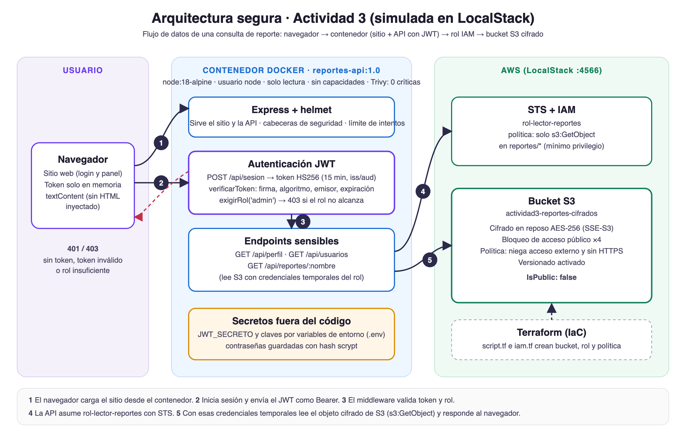

# Actividad 3 · Arquitectura segura con IaC, contenedores, JWT e IAM

Todo corre en local contra **LocalStack** (`http://localhost:4566`, servicios S3, IAM y STS). No se usa AWS real.

| Fase | Carpeta | Qué hay |
|---|---|---|
| 1. IaC con cifrado y bloqueo de acceso | [`fase1-iac`](fase1-iac) | `script.tf`: bucket `actividad3-reportes-cifrados` con AES-256, bloqueo público ×4, versionado y política explícita que niega acceso externo/anónimo y sin HTTPS |
| 2. Contenedores y Trivy | [`fase2-contenedores`](fase2-contenedores) | `escanear.sh` y reportes de Trivy de las tres imágenes (los Dockerfiles están en `fase3-api`) |
| 3. API con JWT y OWASP ZAP | [`fase3-api`](fase3-api) | API Express + sitio web, middleware JWT, pruebas con curl y escaneo de ZAP |
| 4. Política IAM restrictiva | [`fase4-iam`](fase4-iam) | `politica-lector.json` (solo `s3:GetObject` en `reportes/*`), rol `rol-lector-reportes` e `ejemplo-uso.sh` |
| 5. Diagrama | [`fase5-diagrama`](fase5-diagrama) | `arquitectura.svg` / `arquitectura.png` |



## Requisitos

Docker, Terraform ≥ 1.6, AWS CLI v2, Node.js 18+ (solo para correr la API sin Docker), Trivy y OWASP ZAP.
LocalStack se levanta con el `compose.yaml` de la raíz del repo (necesita el token Hobby en `.env`).

Perfil de AWS CLI para LocalStack (no toca el perfil default):

```bash
aws configure set region us-east-1 --profile localstack
aws configure set endpoint_url http://localhost:4566 --profile localstack
aws configure set aws_access_key_id test --profile localstack
aws configure set aws_secret_access_key test --profile localstack
```

## Cómo reproducirlo

```bash
# 0. LocalStack (desde la raíz del repo)
docker compose up -d

# 1. Bucket seguro
cd actividad3/fase1-iac && terraform init && terraform apply
aws s3api get-bucket-policy-status --bucket actividad3-reportes-cifrados --profile localstack   # IsPublic: false

# 4. Rol IAM (antes de la API, porque la API lo usa)
cd ../fase4-iam && terraform init && terraform apply
aws s3 cp resumen.txt s3://actividad3-reportes-cifrados/reportes/resumen.txt --profile localstack
./ejemplo-uso.sh

# 2 y 3. Imagen, escaneo y API
cd ../fase3-api
cp .env.example .env            # cambia el secreto y las claves de demostración
docker build -f Dockerfile.vulnerable -t reportes-api:vulnerable .
docker build -f Dockerfile.node18-sin-endurecer -t reportes-api:node18 .
docker build -t reportes-api:1.0 .
(cd ../fase2-contenedores && ./escanear.sh reportes-api:vulnerable node14 && ./escanear.sh reportes-api:1.0 final-node18)
docker run -d --name reportes-api --env-file .env -p 127.0.0.1:3000:3000 \
  --read-only --cap-drop ALL --security-opt no-new-privileges reportes-api:1.0
./pruebas/probar-api.sh         # 13 casos de autenticación
./zap/escanear-zap.sh           # OWASP ZAP: reportes en zap/
```

Sitio web: <http://localhost:3000>

## Resultados

| Fase | Resultado |
|---|---|
| 1 | `AES256`, 4 controles en `true`, versionado `Enabled`, política explícita, `IsPublic: false` |
| 2 | node:14 → 4 críticas y 64 altas · node:18 sin endurecer → 3 críticas · **node:18 endurecido → 0 críticas y 0 altas** |
| 3 | 401 sin token / token inventado / firma alterada / `alg none` / vencido / otro secreto · 403 por rol · 200 con token y rol correctos. ZAP: ver `fase3-api/zap/reporte-zap.html` |
| 4 | La política adjunta solo permite `s3:GetObject` sobre `reportes/*`; el rol se asume con STS y lee el reporte cifrado |

## API

| Método y ruta | Protección |
|---|---|
| `GET /api/salud` | pública |
| `POST /api/sesion` | pública, máximo 5 intentos por minuto · devuelve JWT HS256 de 15 min con `iss` y `aud` |
| `GET /api/perfil` | JWT |
| `GET /api/usuarios` | JWT + rol `admin` |
| `GET /api/reportes/:nombre` | JWT + rol `admin` · lee S3 asumiendo `rol-lector-reportes` |

Seguridad de la API: secreto JWT y claves solo por variables de entorno, contraseñas con hash scrypt y comparación en tiempo
constante, `helmet` con CSP estricta, token solo en memoria en el navegador y `textContent` para pintar respuestas.

## Limitación conocida

LocalStack Hobby no aplica IAM ni las políticas de bucket (`ENFORCE_IAM` es de los planes Base/Ultimate). Por eso la
validación de las fases 1 y 4 se hace sobre la configuración que reporta la API; en AWS real, las negaciones
(acceso anónimo, HTTP, `s3:PutObject` con el rol lector) responderían `AccessDenied`.
